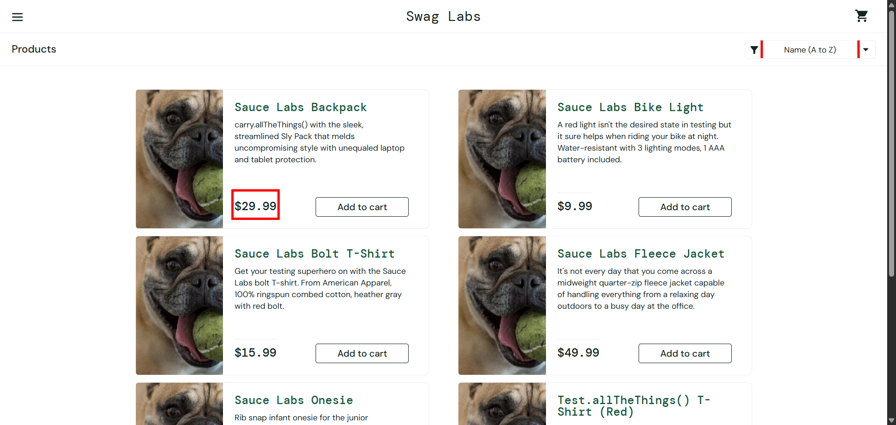
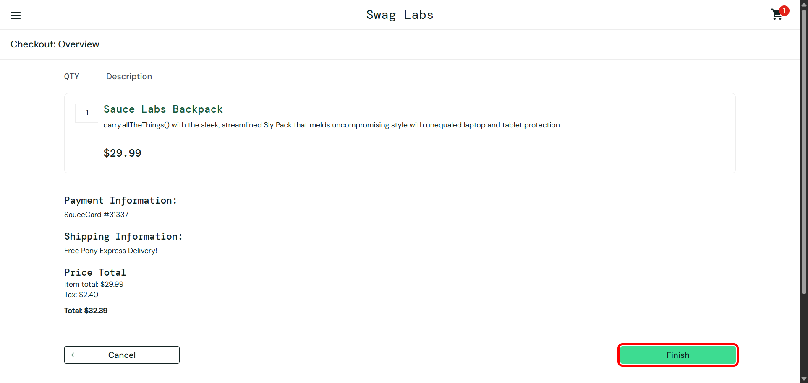
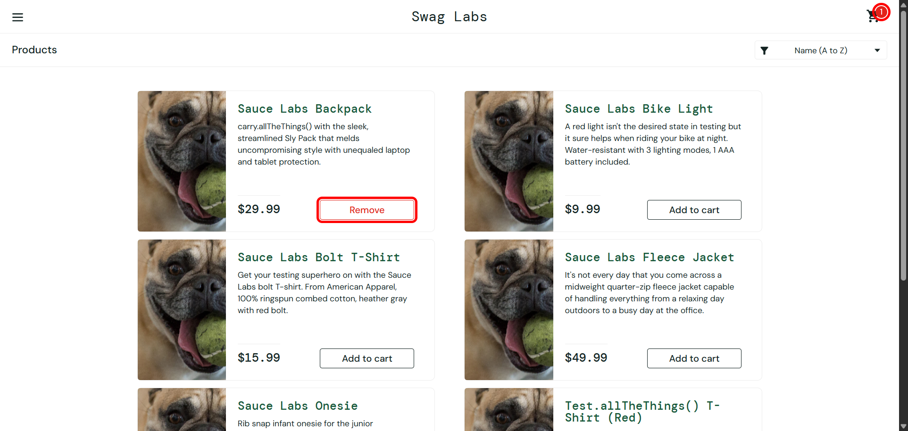
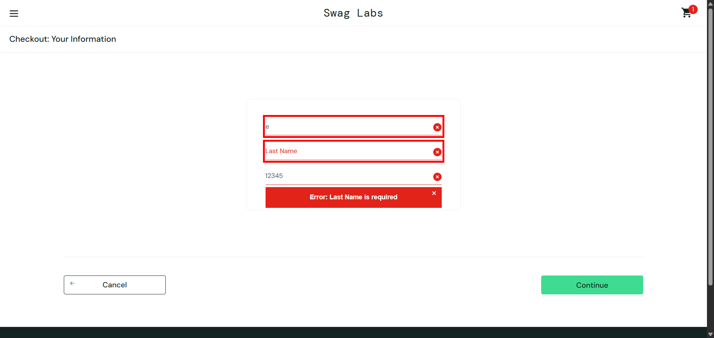
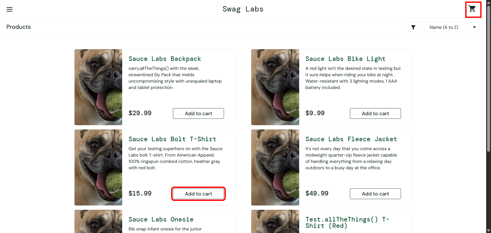
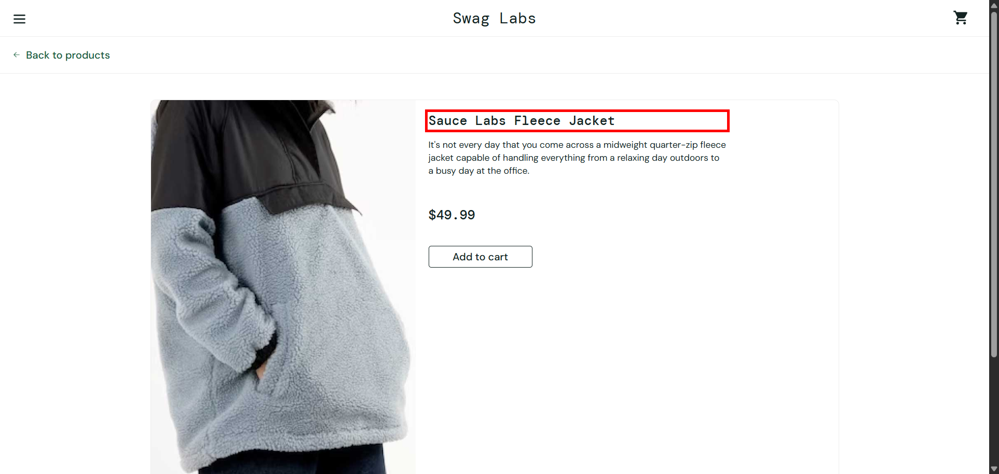
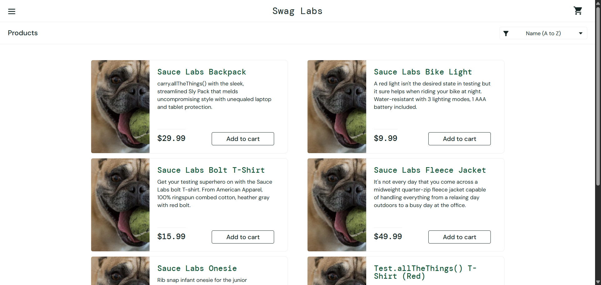
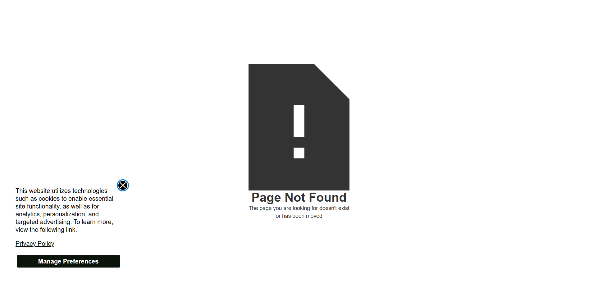

# Bug reports – SauceDemo

SauceDemo has special test accounts with deliberately injected bugs. I treated `problem_user` and `error_user` as a buggy build and `standard_user` as the reference: every **Expected** result below is what `standard_user` sees.

The first three bugs were caught by the automated suite while proving that new tests can fail. The rest were found by exploratory testing of `problem_user`.

## Environment
| | |
|---|---|
| Site | https://www.saucedemo.com |
| Browser | Chrome 157.0.8103.51, window 1920×1080 |
| OS | Windows 11 Pro |
| Password | `secret_sauce` (all users) |
| Tested on | 2026-11-15 |

## Summary
| ID | Title | User(s) | Severity | Priority | Found by |
|----|-------|---------|----------|----------|----------|
| [BUG-001](#bug-001) | Products: sort dropdown does nothing | problem_user | Major | Medium | `SortingTests` ([PR #10](https://github.com/llunasv/saucedemo-selenium-csharp/pull/10)) |
| [BUG-002](#bug-002) | Checkout: Finish button does nothing | error_user | Critical | High | `CheckoutTests` ([PR #12](https://github.com/llunasv/saucedemo-selenium-csharp/pull/12)) |
| [BUG-003](#bug-003) | Products: Remove button does nothing | problem_user, error_user | Major | Medium | `CartTests` ([PR #13](https://github.com/llunasv/saucedemo-selenium-csharp/pull/13)) |
| [BUG-004](#bug-004) | Checkout: typing a Last Name overwrites the First Name | problem_user | Critical | High | Exploratory |
| [BUG-005](#bug-005) | Products: Add to cart does nothing for 3 of 6 products | problem_user, error_user | Critical | High | Exploratory |
| [BUG-006](#bug-006) | Products: product name opens a different product | problem_user | Major | Medium | Exploratory |
| [BUG-007](#bug-007) | Products: every product shows the same placeholder image | problem_user | Minor | High | Exploratory |
| [BUG-008](#bug-008) | Menu: About link opens a "Page Not Found" page | problem_user | Minor | Low | Exploratory |

**Severity** (impact): *Critical* – a core flow is broken with no workaround; *Major* – a
feature is broken but there is a workaround or it is off the purchase path; *Minor* –
cosmetic or low impact.
**Priority** (urgency): *High* – fix before release; *Medium* – fix soon; *Low* – when convenient.

---

## BUG-001 – Products: sort dropdown does nothing

| | |
|---|---|
| User | `problem_user` |
| Severity / Priority | Major / Medium |
| Reproducibility | Always |
| Found by | `SortingTests` – Z→A and both price tests fail ([PR #10](https://github.com/llunasv/saucedemo-selenium-csharp/pull/10)) |

**Preconditions:** logged in as `problem_user`, on the Products page.

**Steps to reproduce**
1. In the sort dropdown, select **Name (Z to A)**.
2. In the sort dropdown, select **Price (high to low)**.

**Expected:** the list is re-ordered and the dropdown shows the chosen option. Z→A starts with *Test.allTheThings() T-Shirt (Red)*; high→low starts with *Sauce Labs Fleece Jacket* ($49.99) and ends with *Sauce Labs Onesie* ($7.99).

**Actual:** after each selection the dropdown jumps back to **Name (A to Z)** and the list keeps the default A→Z order (*Sauce Labs Backpack*, $29.99, first). No error is shown.

**Notes:** `error_user` has the same problem, but also gets a browser alert: *"Sorting is broken! This error has been reported to Backtrace."*

---

## BUG-002 – Checkout: Finish button does nothing

| | |
|---|---|
| User | `error_user` |
| Severity / Priority | Critical / High |
| Reproducibility | Always |
| Found by | `CheckoutTests` – fails with `CheckoutCompletePage did not load` ([PR #12](https://github.com/llunasv/saucedemo-selenium-csharp/pull/12)) |

**Preconditions:** logged in as `error_user`, *Sauce Labs Backpack* in the cart.

**Steps to reproduce**
1. Open the cart and click **Checkout**.
2. Enter First Name `Jane`, Last Name `Doe`, Postal Code `12345` and click **Continue**.
3. On **Checkout: Overview**, click **Finish**.

**Expected:** the **Checkout: Complete!** page opens with *"Thank you for your order!"* and the cart is emptied.

**Actual:** nothing happens. The page stays on **Checkout: Overview** (`/checkout-step-two.html`) and the cart badge still shows 1. The browser console shows `Uncaught TypeError: wa.cesetRart is not a function` when Finish is clicked.

**Notes:** the order cannot be placed – there is no workaround.

---

## BUG-003 – Products: Remove button does nothing

| | |
|---|---|
| Users | `problem_user`, `error_user` |
| Severity / Priority | Major / Medium |
| Reproducibility | Always |
| Found by | `CartTests.RemoveFromCart_OnInventoryPage_HidesBadge` ([PR #13](https://github.com/llunasv/saucedemo-selenium-csharp/pull/13)) |

**Preconditions:** logged in as `problem_user`, cart is empty.

**Steps to reproduce**
1. On the Products page, click **Add to cart** on *Sauce Labs Backpack*.
2. Click **Remove** on *Sauce Labs Backpack*.

**Expected:** the button changes back to **Add to cart** and the cart badge disappears.

**Actual:** the button still says **Remove**, the cart badge still shows 1, and the backpack is still listed on the Cart page.

**Notes**
- Affects every product that can be added: *Backpack*, *Bike Light* and *Onesie* (the other three cannot be added at all – see [BUG-005](#bug-005)).
- Workaround: **Remove on the Cart page works** (`CartTests.RemoveFromCart_OnCartPage_KeepsOtherItems` passes for both users).

---

## BUG-004 – Checkout: typing a Last Name overwrites the First Name

| | |
|---|---|
| User | `problem_user` |
| Severity / Priority | Critical / High |
| Reproducibility | Always |
| Found by | Exploratory testing |

**Preconditions:** logged in as `problem_user`, *Sauce Labs Backpack* in the cart, on **Checkout: Your Information**.

**Steps to reproduce**
1. Type `Jane` in **First Name**.
2. Type `Doe` in **Last Name**.
3. Type `12345` in **Postal Code**.
4. Click **Continue**.

**Expected:** the fields show `Jane` / `Doe` / `12345` and **Checkout: Overview** opens.

**Actual:** after step 2, **First Name** shows `e` (the last letter typed) and **Last Name** is empty. **Continue** shows *"Error: Last Name is required"*, so the customer cannot get past this step.

**Notes:** no workaround known – the purchase cannot be completed.

---

## BUG-005 – Products: Add to cart does nothing for 3 of 6 products

| | |
|---|---|
| Users | `problem_user`, `error_user` |
| Severity / Priority | Critical / High |
| Reproducibility | Always |
| Found by | Exploratory testing (each of the 6 products checked) |

**Preconditions:** logged in as `problem_user`, cart is empty.

**Steps to reproduce**
1. On the Products page, click **Add to cart** on *Sauce Labs Bolt T-Shirt*.

**Expected:** the button changes to **Remove** and the cart badge shows 1.

**Actual:** the button still says **Add to cart** and no cart badge appears.

**Notes**
- Affected: *Sauce Labs Bolt T-Shirt*, *Sauce Labs Fleece Jacket*, *Test.allTheThings() T-Shirt (Red)*. *Backpack*, *Bike Light* and *Onesie* can be added.
- **Add to cart** on the product details page (`/inventory-item.html?id=1`) does nothing either, so these products cannot be bought at all.

---

## BUG-006 – Products: product name opens a different product

| | |
|---|---|
| User | `problem_user` |
| Severity / Priority | Major / Medium |
| Reproducibility | Always |
| Found by | Exploratory testing (each of the 6 products checked) |

**Preconditions:** logged in as `problem_user`, on the Products page.

**Steps to reproduce**
1. Click the product name **Sauce Labs Backpack**.

**Expected:** the details page of *Sauce Labs Backpack* opens (`/inventory-item.html?id=4`).

**Actual:** the details page of *Sauce Labs Fleece Jacket* opens (`/inventory-item.html?id=5`).

**Notes:** every product link opens the product with the next id:

| Clicked | Opened | `standard_user` opens |
|---|---|---|
| Sauce Labs Backpack | Sauce Labs Fleece Jacket (id=5) | id=4 |
| Sauce Labs Bike Light | Sauce Labs Bolt T-Shirt (id=1) | id=0 |
| Sauce Labs Bolt T-Shirt | Sauce Labs Onesie (id=2) | id=1 |
| Sauce Labs Fleece Jacket | **ITEM NOT FOUND** (id=6) | id=5 |
| Sauce Labs Onesie | Test.allTheThings() T-Shirt (Red) (id=3) | id=2 |
| Test.allTheThings() T-Shirt (Red) | Sauce Labs Backpack (id=4) | id=3 |

A customer who adds the product from this page puts the wrong item in the cart.

---

## BUG-007 – Products: every product shows the same placeholder image

| | |
|---|---|
| User | `problem_user` |
| Severity / Priority | Minor / High |
| Reproducibility | Always |
| Found by | Exploratory testing |

**Preconditions:** none.

**Steps to reproduce**
1. Log in as `problem_user`.

**Expected:** each product shows its own photo (e.g. `/assets/sauce-backpack-1200x1500-….jpg`).

**Actual:** all six products show the same picture of a dog; every image source is `/assets/sl-404-Cq1a9k9X.jpg`.

**Notes:** a *low severity, high priority* bug – every feature still works, but every customer sees it on the first page after login and cannot tell what they are buying.

---

## BUG-008 – Menu: About link opens a "Page Not Found" page

| | |
|---|---|
| User | `problem_user` |
| Severity / Priority | Minor / Low |
| Reproducibility | Always |
| Found by | Exploratory testing |

**Preconditions:** logged in as `problem_user`.

**Steps to reproduce**
1. Open the menu (☰) in the top-left corner.
2. Click **About**.

**Expected:** https://saucelabs.com/ opens.

**Actual:** https://saucelabs.com/error/404 opens, showing *"Page Not Found"*.

---

## Other observations (not yet reported)
- `error_user`, **Checkout: Your Information**: typing in **Last Name** has no effect (the field stays empty, and the console logs `Uncaught TypeError: Cannot read properties of undefined (reading 'value')` once per key), yet **Continue** still opens the Overview the "Last Name is required" check is skipped.
